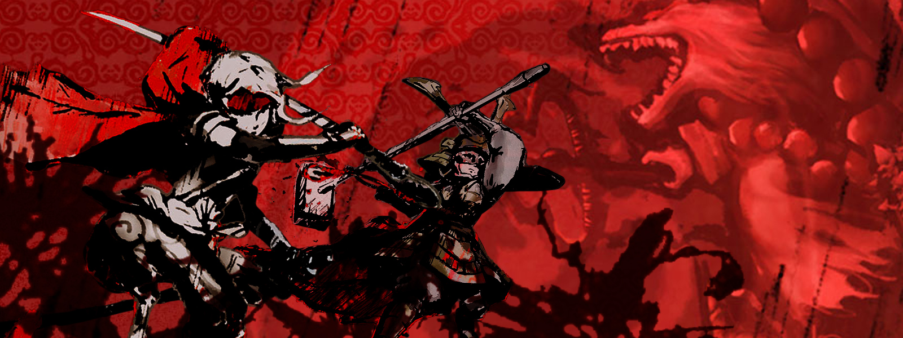
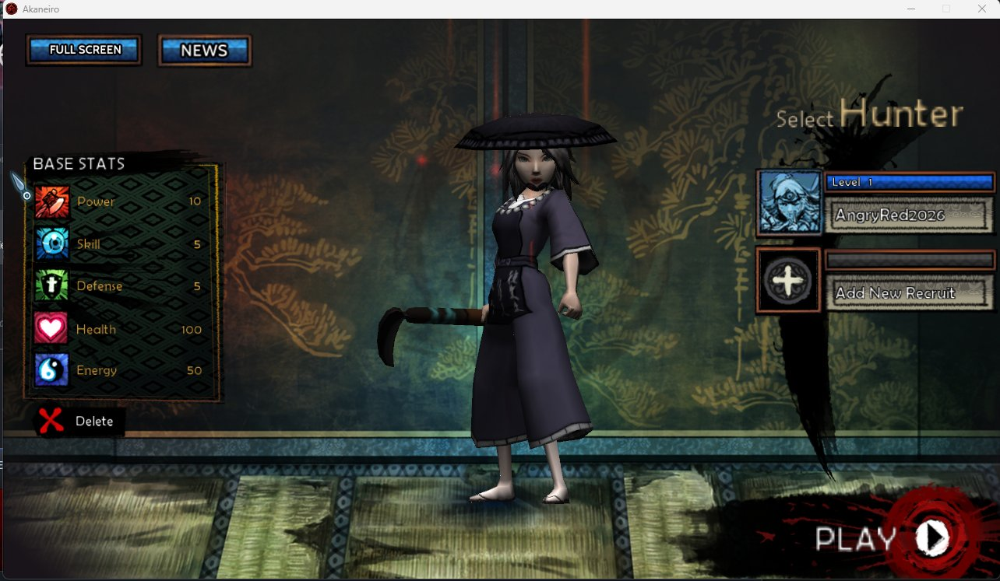
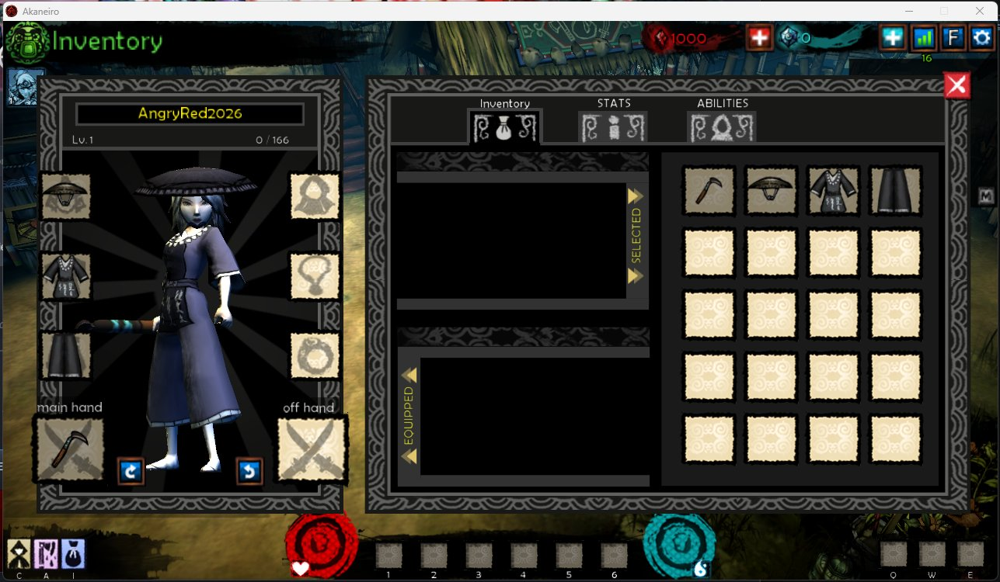

# angry-red
A vibe-coded local/private server for American McGee's Akaneiro Demon Hunters



## Why?
This game was a passion project of American McGee back in 2011 on [Kickstarter](https://www.kickstarter.com/projects/spicyhorse/akaneiro-demon-hunters/description). The idea of red riding hood in folklore japan, being played as Hack 'n Slay/Diablo clone - well that was really nice. It was a cool small game with nice music and cool ideas. It also didn't take itself so seriously, with the "LordGaben" penguin as a DLC or a big fly swatter as a powerful melee weapon. It was awesome! Sadly the team was a bit overwhelmed with us users and somewhere the server source code got lost. Somewhere in spring 2022, the RAID of the Akaneiro server died and with it the last copy of the server binary. Should we be able to get our hands on those binaries today, we probably would have a working version in no time... But, well. As no one took up the mantel, I thought I'd give it a go, its nothing big, but it might be a start for someone more talented, with some Unity background?

## (Low) Expectations
You can start the game, you can create/delete characters, you can load into the tutorial and even click some characters, run around (very fast) and via the menu exit the tutorial/directly move to the village. There, you can run around some more. That's it. Nothing more, nothing less. But I think it is a good start. If someone wants to carry the torch from here, be my guest :).

## Special thanks to
- [American McGee](https://www.americanmcgee.com) for allowing the source to be open!
- [@skotopes](https://github.com/skotopes) for getting and relasing the source
- The Akaneiro Demon Hunters "Ugly hack to run game, while we preparing new build" thread on Steam. Holding up the torch since 2018!

## Development info
This software was vibe-coded (locally) using Qwen3.8 27B and Qwen3.6 35B A3B UD. I despise AI. I hated every second of it, but at least my room was cozy-warm (and darn loud).

The workflow was following:
Using LM Studio/Bionic to set-up a new workspace with following contents:
- The source code of the client: https://github.com/SpicyHorseLegacy/akaneiro-client
- The compiled Steam client, copied over from C:\Program Files (x86)\Steam\steamapps\common\Akaneiro Demon Hunters
- I also created some pcap files back in the day, though sadly only for some very rough stuff, should have done more...



## Getting it to work
System hosts file (C:\Windows\System32\drivers\etc\hosts) overrides all DNS entries for SpicyHorse/Akaneiro - realisticly only the last address should be needed, don't forget the reboot after that.

````
127.0.0.1 spicyhorse.com
127.0.0.1 angry-red.com
127.0.0.1 mw.angry-red.com
127.0.0.1 spicyworld.spicyhorse.com
````

The workflow followed then to point the model at different landmarks, e.g. CS/comm code and let it generate two servers:
- auth_server.py: runs on port 80, does the complete workflow of "logging the user in", either via Steam or the old Web client (with username/password) and hands over the address of the game server
- game_server.py: runs on port 8080, does all the game logic stuff.

Just run both servers via python and leave open. Congrats, you should be able to login with your Steam client.

This project involved a lot of start gaming, testing, re-working. Getting the LLMs out of loops and logic bombs. Never a dull moment. But loads of waiting.



## The dirty secrets
- All Akaneiro Games have a debug file enabled! C:\Program Files (x86)\Steam\steamapps\common\Akaneiro Demon Hunters\Akaneiro_Data\output_log.txt
- Some asset stuff only works in compiled form, so you might have to analyse those nice .assetbundle files via hexeditor
- There were multiple versions of the game: A version in the Unity Web Player via Browser, plus two fat clients, one with Web Login, one with Steam Login. Within the game there is a lot of logic to pull assets from a webserver. That does not work for the fat clients, because within the fat client, those are hardcoded to use the local assets. This became a point of impressive arguments. Don't ask, just know it exists and can become a pitfall. Yes, file:// doesn't work on windows, HOWEVER, this is why the developers coded a RELATIVE addressing schema with ../assetbundles
- A lot of logic exists in the server, existED in the server, RIP RAID. So if we want to have fights and stuff, we might need to add all of that painfully

## The Unity Affair
- The LLM thinks it was created with Unity 4.1.5 - which is 4.1.5f1. There some hints in procedures to Unity 4.2.2 though. I am not a Unity person, so I cannot confirm. If I where, this would probably be a lot easier.
- No matter, 4.1.5f1 or 4.2.2 - these old versions are not available via Unity anymore, nor can you activate them after download. In the past, these versions were free for personal use. You could install Unity, unplug network/wifi, start the application and it will find that its offline and wants to create an offline activation file. You can get that... but you cannot use it anymore, because Unity only allows professional users to activate these old versions. The personal license/free license has been killed off... HOWEVER:
- You can find the download of the older versions on the Internet Archive (GOAT, yet again!) - https://archive.org/details/old-unity-editor-archive
- In regards to using it after installing it offline, I am sure someone has written some kind of tool to patch Unity 4.x to Pro
